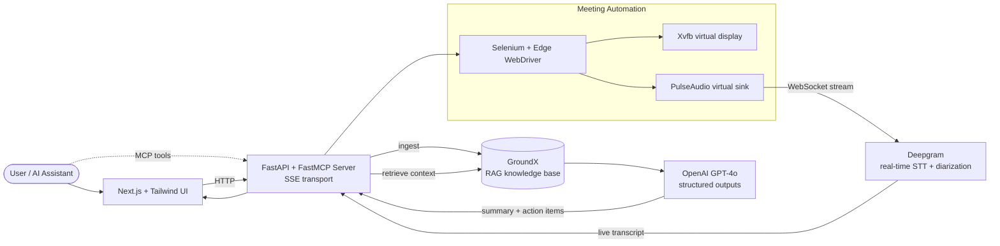

# MeetScript AI

**An AI meeting agent that joins Google Meet calls, transcribes them in real time, and lets you query the transcript with natural language — exposed as MCP tools any AI assistant can call.**

MeetScript programmatically joins scheduled Google Meet sessions, streams the live audio to Deepgram for real-time speaker-diarized transcription, ingests the transcript into a GroundX-backed RAG store, and uses OpenAI structured outputs to pull summaries and actionable items out of the conversation. The whole pipeline is wrapped in a FastAPI + FastMCP server with SSE transport, so any MCP-compatible AI assistant can drive it.

---

## 🎬 Demo

<!-- Replace demo.gif below with your converted clip -->
<p align="center">
  
</p>

---

## 🏗 Architecture



**What happens end to end:**

1. User supplies a Meet URL and API keys through the Next.js UI (or an MCP client).
2. FastMCP server spins up a Selenium-driven Edge browser inside a headless Xvfb display.
3. Meeting audio is routed through a PulseAudio virtual sink and streamed to Deepgram over WebSockets.
4. Transcripts land in `transcript.txt` in real time and are ingested into GroundX as a searchable knowledge base.
5. Queries hit the `search_doc_for_rag_context` MCP tool, which retrieves relevant chunks and passes them to GPT-4o with a Pydantic response schema to return structured summaries and action items.

---

## ✨ Features

- **Headless Google Meet agent** — Selenium + Edge WebDriver running inside Xvfb, with persistent browser profiles so 2FA only happens once.
- **Real-time transcription** — Deepgram streaming API with speaker diarization and live subtitle output (VTT/SRT supported).
- **RAG on meeting transcripts** — GroundX ingestion and semantic retrieval, scoped per meeting.
- **Structured summaries** — OpenAI GPT-4o structured outputs return a typed `MeetingTranscriptResponse` with summary, action items, assignees, and deadlines.
- **MCP-native** — every capability is exposed as an MCP tool over SSE, so Claude Desktop, Cursor, or any MCP client can drive it directly.
- **Fully containerized** — Docker Compose brings up the browser, virtual display, audio stack, and API server with one command.

---

## 🧰 Tech Stack

**Backend:** Python 3.10, FastAPI, FastMCP, Selenium, Deepgram SDK, GroundX, OpenAI SDK, PyAudio
**Frontend:** Next.js 15, React 19, TypeScript, Tailwind CSS
**Infra:** Docker, Docker Compose, Xvfb, PulseAudio, Microsoft Edge + msedgedriver

---

## 🔧 MCP Tools Exposed

| Tool | Purpose |
|---|---|
| `echo_tool` | Health check / connectivity test |
| `transcribe_google_meet_tool` | Join a Meet URL and transcribe for N seconds |
| `ingest_document` | Push the generated transcript into the GroundX knowledge base |
| `search_doc_for_rag_context` | Query the transcript and get a structured summary + action items |

---

## 🚀 Quick Start

### Prerequisites

- Docker & Docker Compose
- API keys for: Deepgram, OpenAI, GroundX
- A Google account available for the agent to sign in with

### Run the backend

```bash
cd backend
cp .env.example .env   # fill in GOOGLE_USERNAME, GOOGLE_PASSWORD, DEEPGRAM_API_KEY, MEET_URL
docker-compose up --build
```

The FastAPI + FastMCP server starts on `http://localhost:8000` and exposes SSE at `/sse`.

### Run the frontend

```bash
cd frontend
npm install
npm run dev
```

Open `http://localhost:3000`, drop in your Meet URL and API keys, and click **Join Meeting & Extract Transcript**.

### Drive it from an MCP client

Point any MCP client at `http://localhost:8000/sse`:

```
"Join the meeting at https://meet.google.com/abc-defg-hij and transcribe for 30 minutes"
"What were the main discussion points and who was assigned what?"
"List every action item with its deadline"
```

---

## 📁 Project Structure

```
MeetScript/
├── backend/
│   ├── server.py            # FastAPI + FastMCP server, MCP tool definitions
│   ├── script.py            # Selenium Google Meet automation
│   ├── realtime_stream.py   # Deepgram WebSocket streaming + VTT/SRT output
│   ├── Dockerfile           # Python + Edge + Xvfb + PulseAudio
│   ├── docker-compose.yaml
│   └── entrypoint.sh        # Boots Xvfb, PulseAudio, then server.py
├── frontend/                # Next.js 15 + Tailwind UI
└── client.py                # Reference MCP + OpenAI client (SSE)
```

---

## 🗺 Roadmap

- [ ] Multi-meeting concurrency (one container per meeting)
- [ ] Zoom and Teams adapters (same MCP surface)
- [ ] Per-meeting GroundX buckets so transcripts don't collide
- [ ] Webhook notifications on meeting end with signed summary URL
- [ ] Streaming action-item extraction during the call, not just after

---

## 📝 License

MIT

---

Built by [Akinropo Olabisi](https://github.com/Vinci-virtuoso) — Voice AI Engineer working on production LLM systems, conversational AI, and agentic workflows.
