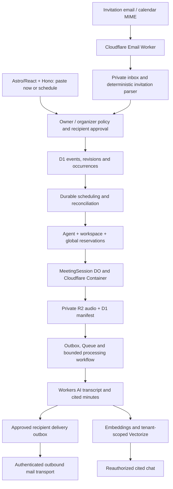

# Architecture — email-addressed personal meeting agents

Version 1 · 7 November 2026. Proposed design, not a claim of deployed components. Follow [PRD.md](PRD.md) and inherited tenant/media security invariants. New table/endpoint names below are design contracts, not existing migrations or APIs.

## 1. System boundaries

Keep a small number of deployable units: web Worker, inbound Email Worker where its email event requires it, and jobs/control Worker owning schedules, DOs, capture coordination, processing and delivery jobs. Share typed contracts, not duplicated policies. Core app/capture/processing runtime stays on Cloudflare. Email transport is an explicit integration boundary.

Cloudflare Email Routing/Email Workers supplies receipt/handling; it is not an IMAP mailbox or, by itself, a general outbound mail service. The app builds its own private inbox using D1 metadata and tightly retained R2 payloads. Verify current Cloudflare Email Service eligibility, sender verification, destination restrictions, limits, delivery events and idempotency for this account before selecting it. If unavailable, hold mail delivery as blocked and obtain an owner-approved transport decision; do not silently install an unrelated provider.

One inbound alias per user does not require one Worker or provider mailbox per user. Route an owner-controlled agent subdomain into an Email Worker, resolve an opaque active address to its owner, and apply authorization before side effects. Catch-all routing, sender DNS records and any domain changes need concrete setup and owner authorization; no domain is assumed approved.

## 2. Identity, ownership and approval

Separate these identities explicitly:

1. App user: verified login identity owning the agent.
2. Agent email: routable address and inbox; it conveys no Google credentials.
3. Meeting organizer: event authority linked to an approved organizer policy.
4. Recording participant: visible browser participant admitted under the meeting's rules.
5. Recap recipient: approved email identity with a scoped content grant, where authorized.

`agents.user_id` is unique for an active agent. The agent's default workspace is a routing default only. Pin `workspace_id`, `agent_id`, owner, organizer approval, consent policy, recipient-list revision and event revision on each accepted event. Recheck all applicable current authority at execution; historical approvals alone cannot override revoked membership, a cancelled event or a tombstone.

Receiving an email for a known alias is never sufficient authority. Normalize envelope/header claims and provider authentication results; link them to the owner-approved organizer policy. Unknown or conflicting identities require authenticated owner review. Do not use a display name, arbitrary Reply-To, forwarded body, LLM classification or calendar attendee field as authority. The parser never follows an invitation link to fetch arbitrary content.

An external organizer without a MeetScript account can be authorized by the owner under a scoped standing policy. Store how the organizer identity and recipient list were verified. If authentication evidence is insufficient or ambiguous, hold rather than infer approval.

## 3. Inbound email and calendar normalization

Bound raw message size, MIME depth, attachment count, calendar size, line length and event count before fully buffering or expensive parsing; choose tested limits against the actual service envelope. Retain only necessary fields. Escape subject/body in the UI and never render untrusted HTML directly. No attachment execution, remote-image fetches, arbitrary URL fetches or model tool calls.

Persist inbound receipt and a deterministic parse outbox intent before acknowledgement where the platform permits; service retries and uncertain receipt must deduplicate. A message fingerprint includes the resolved agent and content hash, with Message-ID as supplementary metadata rather than trusted uniqueness. Address resolution, parse errors and delivery loops must not leak another user's address/inbox state.

Normalize `.ics` using a maintained RFC 5545/5546-aware parser with license/compatibility review. Validate METHOD, UID, SEQUENCE, DTSTAMP, ORGANIZER, DTSTART/DTEND/DURATION, TZID/VTIMEZONE, RRULE/RDATE/EXDATE and RECURRENCE-ID. Ignore unrelated attachments. An invitation with multiple events/links requires deterministic supported handling or explicit review; no first-link guess.

Event key: `(agent_id, normalized_organizer_identity, calendar_uid)`. Detached occurrence key adds original recurrence identity. Persist a semantic revision and payload hash. SEQUENCE/DTSTAMP are calendar ordering evidence, not permission checks: stale or conflicting same-sequence changes do not overwrite newer authoritative state. Cancellation or rescheduling invalidates dispatch jobs using a monotonically increasing internal revision. Bound recurrence expansion; unsupported rules enter review.

Use one parser/approval model for pasted links, creating an internal event UID. The same occurrence cannot be independently dispatched by the inbox and paste paths when the owner explicitly links them; retries are idempotent. Do not globally merge separate private owners' events by Meet code.

## 4. Durable scheduling and attendance

D1 is the durable schedule and revision source; a scheduling DO serializes changes and maintains an alarm for the next due occurrence. A periodic reconciler discovers missed wakeups, tombstones and orphan reservations. Use a durable dispatch outbox. Alarms, queues and cron can deliver more than once; no exactly-once timer assumption or in-memory sleep.

At dispatch, atomically claim an occurrence revision/lease, then recheck active owner/workspace membership, current agent status, organizer approval, consent procedure, approved recipients, latest event time/cancellation and pilot budget. Reserve agent, workspace and global capacity using a recoverable saga, with one fenced dispatch identity. A response lost after start triggers reconciliation, never a blind second start.

Persist manual Now/Scheduled authorization separately from email-derived authorization. An old alarm carries IDs and expected revision; it cannot supply a fresh URL or recipient list. Dispatch loads current server-side data. Changes to the default workspace do not rewrite persisted occurrences.

Cancellation before dispatch fences the occurrence and releases confirmed-unused reservations. During startup/admission/recording, cancellation requests a confirmed stop. Stop wins over stale start/admission events; hard-loss recovery handles saved chunks without silently rejoining. A cancelled event cannot return via a stale recurring-series expansion.

For first release, proposed late-start tolerance is two minutes, subject to real tests and owner policy. A later wakeup becomes missed/needs-action, not an unannounced late join. Define explicit behavior for overlaps and capacity exhaustion; report blocked/conflict and notify the owner, without creating an extra bot or assuming another user's reservation can be released.

Quota keys and active Meet-code locks must include agent/privacy ownership so deduplication cannot merge another user's private meeting. Workspace/global coordinators account for all captures regardless of agent. A same-link collision can be blocked without disclosing another owner's title, recording or identity. These changes require migration from the foundation's workspace-wide active-code uniqueness; that existing index is not sufficient for personal-agent semantics.

## 5. Capture and processing

Retain the custom Chromium/virtual-audio/FFmpeg Container and MeetingSession DO design. G0 must establish actual allowed guest admission, audio devices, WebRTC networking, instance suitability, readiness, image digest, no-UI-traffic lifetime, graceful stop, hard loss and partial upload recovery. Consult current APIs rather than implementing old snippets as platform facts.

Mail routing does not solve authenticated Google attendance. Do not inject Google passwords, imported cookies or copied profiles. Authentication-required/denied/challenge outcomes remain explicit blockers. A later supported authenticated identity solution needs its own design and live gate.

Capture manifests and runner credentials are scoped to workspace/meeting/session/epoch and expire/revoke on stop, deletion or authority loss. The runner gets no account-wide Cloudflare or mail credentials. Use bounded independently playable audio chunks, checksums and manifest persistence. Consent evidence is recorded against the approved procedure; a calendar acceptance is not evidence that recording consent was obtained.

Queue messages carry IDs, not full mail/audio/transcripts. Bounded workflow: finalize manifest → STT per chunk → versioned transcript/gaps → schema/citation-validated minutes/actions → immutable recap artifact → independent embedding/indexing branch. Pin model IDs, input limits, embedding dimensions and prompt/schema versions after current-documentation and real-input validation. No recap release from an unvalidated or empty transcript. Partial evidence can generate a clearly partial recap only under the approved delivery policy.

Index full authorized transcript chunks for RAG. Minutes must account for the available meeting through bounded coverage/merge passes, rather than summarizing just the nearest semantic search hits. Reauthorize retrieved sources and cite exact versions/segments/times. RAG remains read-only and cannot change recipients, schedules, approvals or actions.

## 6. Recipient approval, guest access and delivery

Store recipient list revisions independently from raw calendar ATTENDEE data. An owner-approved organizer policy may approve a fixed list or explicitly constrained changes; a spoofed update cannot expand it. Approval records bind the event/meeting, list fingerprint, approval authority and policy revision. Recheck before every dispatch to the mail provider. If approval is withdrawn after processing, suppress unsent jobs.

Guests use a distinct `meeting_guest_grants` concept; do not turn them into workspace members. Grant scope includes meeting, recipient identity, allowed artifacts and expiry. Links resolve through verified-email authentication and current grant checks. A forwarded link or knowledge of an email address alone grants no content access. Guest RAG is restricted to explicitly granted meetings; transcript/audio access may be narrower than recap access under owner policy.

Prepare one recipient-specific delivery row from a fixed recap version. Suggested delivery key: `(meeting_id, recap_version, normalized_recipient, send_intent_id)`. An automatic initial send uses a stable intent; explicit resend creates a new intent with an audit reason. Generation retry/regeneration does not create another initial send. Keep delivery provider credentials outside the capture runner.

Persist outbox intent before contacting the provider; workers claim a lease and reauthorize after the claim. Snapshot immutable rendered content plus content/recipient approval versions. Use the provider's verified idempotency feature where available. On a timeout after possible acceptance, reconcile by provider key/status; if unsupported, mark unknown and hold for operator resolution rather than blindly sending again. Bounded retry/backoff and DLQ apply to definitive retryable failures.

Authenticate provider callbacks; verify message/recipient mapping, event ordering and replay protection. Provider-accepted and recipient-delivered are distinct states, and bounce/complaint suppress future automated sends according to policy. Default individually addressed messages do not reveal other recipients. HTML/text templates escape model/transcript content and links never embed public recording URLs.

Deletion cannot recall an already delivered email or a provider request already accepted. Suppress pending deliveries, revoke meeting links, disclose external-copy limits, and keep the minimum lawful/approved non-content audit. Coordinate tombstones and send leases to minimize the in-flight window without claiming an impossible cross-service transaction.

## 7. Proposed data additions and constraints

All meeting/event/delivery content carries workspace keys and composite references. Agent/inbox records are owner-private; cross-workspace routing cannot broaden readership.

| Entity                                       | Important fields and invariant                                                                                                                   |
| -------------------------------------------- | ------------------------------------------------------------------------------------------------------------------------------------------------ |
| `agents` / `agent_addresses`                 | user, display name, active address, default workspace, status, revision; one active user-owned agent, retired addresses never reused             |
| `organizer_policies`                         | agent/owner, verified organizer identity, scope, consent/recipient rules, revision, approved/revoked audit                                       |
| `inbound_messages`                           | agent/owner, optional resolved workspace, receipt/fingerprint, parse state, private payload key/expiry; bounded dedup                            |
| `meeting_events` / `event_revisions`         | workspace, agent, calendar UID/organizer, source/message reference, timezone, normalized event, semantic revision, cancellation tombstone        |
| `meeting_occurrences`                        | workspace/event, original recurrence identity, UTC time, revision, dispatch lease/epoch, deadline and terminal state; unique occurrence identity |
| `approval_records`                           | owner/organizer authority, event/consent/policy revisions, approved scope and time; no approval from model output                                |
| `recipient_lists` / `recipient_list_entries` | workspace/event/meeting, immutable list revision/fingerprint, addresses, approval revision and revocation                                        |
| `meeting_guest_grants`                       | workspace/meeting, verified recipient identity, artifact permissions, expiry/revocation; no workspace membership implied                         |
| `recap_versions`                             | workspace/meeting, exact minutes/transcript source versions, partial/completeness label, rendered artifact hash and source expiry                |
| `recap_deliveries` / `delivery_events`       | recap/list revision, one recipient, stable send intent, provider key/lease, status, attempts and authenticated event IDs                         |

Extend existing capture, usage, outbox, deletion and audit tables with agent/occurrence identities and appropriate uniqueness. Add tenant-safe indexes for inbox/date, due schedules, event revisions, recipient delivery and retry queues. No migration is introduced by this specification; use additive migrations and test backfills/default workspace selection before runtime changes.

## 8. Proposed API and UI contracts

Retain typed `{error,message,requestId,fields?}` errors, no-store private responses, same-origin mutations, active session/membership checks and expected-revision conflicts. Proposed endpoints:

- `/api/agent`: user-owned identity, address/status, default workspace and policies; does not expose another user's inbox.
- `/api/agent/inbox` and `/:message`: bounded owner-private lists/details; approve/reject resolves a pinned workspace and event revision.
- `/api/workspaces/:w/events` and `/events/:e`: create now/scheduled from pasted link, view revisions, update/cancel with expected revision.
- `/api/workspaces/:w/occurrences`: stable cursor/timezone-aware scheduled list; manual retry requires fresh authority and consent.
- `/api/workspaces/:w/meetings/:m/recipients`: view/approve/change exact recipient list with revision checks.
- `/api/workspaces/:w/meetings/:m/recaps`: delivery status and explicit resend with idempotency key; no arbitrary compose-and-send endpoint.
- Guest artifact endpoints require verified identity plus per-meeting grant; internal email/capture/provider callback handlers have separate authentication and validation contracts.

Use the new route/state matrix in PRD FR-A08. Keep the existing notebook; add agent/inbox/scheduled/delivery experiences and honest infrastructure-unavailable states. No fake inbox messages, acceptance replies, scheduled bot presence, delivery badges or recording signals outside clearly labelled samples.

## 9. Operations and release boundaries

Separate preview/prod agent domains, inbound routes, databases, private buckets, AI/vector resources, mail credentials and callback verification secrets. Names-only settings include an approved agent domain, inbound route, outbound sender/service binding and provider callback verifier in addition to the existing Cloudflare/app bindings. Configure secret values only in secure environment settings. No reusable resource IDs or assumed sender domains.

Measure inbox parse/rejection rates, schedule lag/missed events, lease conflicts, admission outcomes, recording heartbeat/audio progress, processing/DLQ age, recipient holds, provider acceptance/unknown/bounces and deletion lag. Log opaque IDs and reason codes, not mail bodies, full Meet URLs, tokens, transcripts or recipient rosters.

Drains pause new dispatch, preserve future schedules and let active captures finish within approved limits or stop explicitly. Rollbacks preserve parser/event schema compatibility and delivery idempotency history. Restores replay cancellation/deletion tombstones and sent-delivery ledger before reopening dispatch, reads or email sending. Never replay a queue into duplicate meetings or recaps.

Before general release, validate inbound domain routing and supported calendar clients, outbound deliverability and idempotency behavior, Container G0, complete real recap journey, scheduled update/cancel/restart, external guest denial matrix and deletion/send races. All of those remain unverified until recorded in ACCEPTANCE.md.

## 10. Platform references and evidence boundary

Cloudflare Email Workers and Email Service documentation pages were successfully fetched on 7 November 2026. Fetching documentation proves neither account eligibility nor domain configuration, delivery permissions or working integration. Verify the current service constraints and account capabilities before selecting transports:

- https://developers.cloudflare.com/email-routing/email-workers/
- https://developers.cloudflare.com/email-service/
- https://developers.cloudflare.com/containers/api/durable-object-container/
- https://developers.cloudflare.com/containers/platform-details/
- https://www.rfc-editor.org/rfc/rfc5545
- https://www.rfc-editor.org/rfc/rfc5546

DNS, mail sending, external invitations, real meeting attendance and preview/production deployment are distinct actions; this document performs none of them. Prepare concrete setup and use the owner's applicable authorization before executing them.
